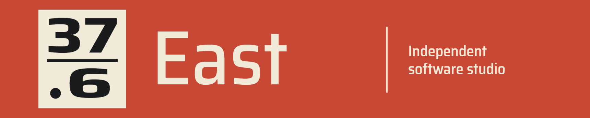

<picture>
  
</picture>

37.6 East is based in Moscow.

## Projects

- **[Prismestra](https://github.com/376east/prismestra)** — Synchronize PC lighting, supported Bluetooth strips, LCDs, and home lights in one scene. · [Windows Setup](https://github.com/376east/prismestra/releases/tag/v0.1.0-preview.7)
- **[Burrow](https://github.com/376east/burrow)** — Build Minecraft modpacks and play with friends from one desktop launcher. · [Windows, macOS and Linux](https://github.com/376east/burrow/releases/latest)
- **[Куплено](https://github.com/376east/kupleno)** — Покупки, возвраты и чеки Ozon, Wildberries и Яндекс Маркета в одном журнале. · [Скачать расширение](https://github.com/376east/kupleno/releases/tag/v0.22.15-preview.1)
- **[FaceFlow](https://github.com/376east/faceflow)** — Let guests find and download their event photos with a selfie. · [Windows source bundle](https://github.com/376east/faceflow/releases/latest)

[Русская версия](README.ru.md)
