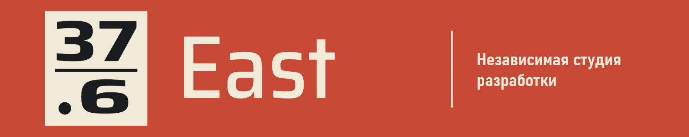

<picture>
  
</picture>

37.6 East — студия из Москвы.

## Проекты

- **[Prismestra](https://github.com/376east/prismestra)** — Подсветка ПК, ленты, LCD и совместимые домашние светильники в одной сцене. · [Установщик Windows](https://github.com/376east/prismestra/releases/tag/v0.1.0-preview.7)
- **[Burrow](https://github.com/376east/burrow)** — Лаунчер Minecraft для своих сборок и игры с друзьями. · [Windows, macOS и Linux](https://github.com/376east/burrow/releases/latest)
- **[Куплено](https://github.com/376east/kupleno)** — Покупки, возвраты и чеки Ozon, Wildberries и Яндекс Маркета в одном журнале. · [Скачать расширение](https://github.com/376east/kupleno/releases/tag/v0.22.15-preview.1)
- **[FaceFlow](https://github.com/376east/faceflow)** — Участники съёмки находят свои кадры по селфи и скачивают подборку. · [Пакет для Windows](https://github.com/376east/faceflow/releases/latest)

[English](README.md)
